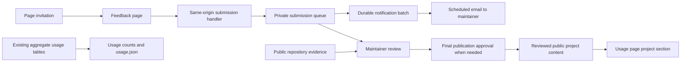

# PRD 037: Feedback, stories, and GitHub stars

> Implementation note (2026-11-08, superseded by the status line below): the approved
> planning text is preserved. The first implementation used a database queue; PR #255
> replaced it with a direct browser-to-Formspree post. See
> [implementation and operations](../community-feedback.md) for verified behavior and
> M3's deliberate deferral. No submitted story is published automatically.

**Status:** Partly shipped (2026-11-09). `/feedback` is live and posts from the browser to Formspree (PRs #252 and #255); the database-queue path from the first implementation was removed. Story publication is manual after written approval, and the M3 prompt experiment is deliberately deferred. See [`docs/community-feedback.md`](../community-feedback.md). The planning text below is preserved as written.

**Created:** 2026-11-08

**Author:** Anthony + Codex

**Surfaces:** `/feedback`, `/usage`, `/api`, school and year pages, footer, repository documentation

**Related:** [PRD 013](013-analytics-and-abuse-signal.md), [PRD 022](022-mcp-cli-readiness.md), [PRD 024](024-share-button.md), [PRD 033](033-public-usage-page.md), [copy deck](../copy/037-feedback-stories-and-github-stars.md), [voice](../../web/VOICE.md), [design system](../../web/DESIGN_SYSTEM.md), [API attribution](../api-usage-attribution.md)

---

## One-line job

Make it easy to tell the maintainer what helped, what needs fixing, and what
someone built, with an optional invitation to star the GitHub repository.

## Executive summary

People are using collegedata.fyi without starting a conversation with its
maintainer. Public repositories already contain integrations, source credits,
and accounts of work the archive saved. The public usage page measures activity
carefully, but does not invite those people to identify themselves voluntarily
or explain what the data helped them do.

Add one short, account-free website form, reachable through permanent feedback
links and context-specific invitations. Keep email available beside the form.
Notify `contact@bolewood.com` of new messages through a private, retryable
email digest; do not depend on the owner remembering to inspect a database.
Add a sourced project section to `/usage`, distinguishing independently observed
public reuse from stories approved by their authors. Invite GitHub stars where
developers are already working with the project.

Ship useful, quiet invitations before experimenting with a prompt like the Orca
example. Keep all data, downloads, and API access available without responding.
This is community participation for an open public resource, not a payment or
account funnel.

## Starting point: measured facts and unknowns

Repository inspection and the GitHub audit were performed on 2026-11-08.

| Observation | Evidence | What it establishes |
|---|---|---|
| The repository has 14 stars and four public forks | GitHub repository and forks APIs, `bolewood/collegedata-fyi` | A dated baseline; neither paying demand nor active use by every fork |
| Thirteen non-fork public repositories contain implementation evidence or explicit attribution | Public-source audit below | Public evidence of reuse or attribution; not thirteen production customers |
| `/usage` publishes downloads, API counts, distribution, and methodology | `web/src/app/usage/page.tsx` | An existing home for evidence of usefulness |
| The footer links GitHub but has no feedback invitation | `web/src/components/Footer.tsx` | GitHub is discoverable; the reason to contact us is not explicit |
| The API page exposes `contact@bolewood.com` for bulk work | `web/src/app/api/page.tsx` | An existing email fallback; inbox access and delivery still need a launch check |
| GitHub has forms for bad extracted data, adding schools, and contributing cleaners | `.github/ISSUE_TEMPLATE/` | Existing specialist reporting paths, not a general story submission flow |
| The web app already has `trackEvent`, `TrackedLink`, and server-side Supabase access patterns | `web/src/lib/analytics.ts`, `TrackedLink.tsx`, `change-intelligence-admin.ts` | Components and infrastructure to reuse |
| The existing MCP rate limiter is a process-local `Map` | `web/src/lib/mcp/rate-limit.ts` | It is not a shared admission limit across serverless instances |
| No website feedback route, submission queue, or transactional mail integration was found in the inspected web code | `web/src/app/api/`, `web/package.json`, source searches | A form needs a real write path and an operating plan |
| Discord workflow notifications use an explicit workflow allowlist | `.github/workflows/ops-discord-notify.yml`, `tools/ops/notify_discord.py` | A new notification worker will not automatically inherit failure alerts |

Anthony reports little or no unsolicited email or issue activity. We have not
audited the mailbox or established a historical response rate. There is no
measured invitation-view or form-conversion baseline. Zero measured submissions
before a form exists is not evidence that visitors will not respond.

### Public reuse evidence

These are research leads for factual references and future conversations. They
are not testimonials, endorsements, publication permissions, or a contact list
derived from visitor logs. No outreach is authorized by this PRD alone.

| Repository | Evidence checked | Classification |
|---|---|---|
| [ian-shafer/unicoach](https://github.com/ian-shafer/unicoach/blob/main/bin/fetch-cds-seed) | API importer, `unicoach` client label, committed fetch provenance | Integration evidence |
| [munkhtumur-spec/AidAtlas](https://github.com/munkhtumur-spec/AidAtlas/blob/main/backend/app/services/collegedata.py) | API client and [README attribution](https://github.com/munkhtumur-spec/AidAtlas#attribution) | Integration and explicit credit |
| [vasud93-sudo/university-project](https://github.com/vasud93-sudo/university-project/blob/main/scripts/fetch-cds-data.js) | Friendly API and PostgREST importer; README source credits | Integration and explicit credit |
| [Prekurso-r/College_Match](https://github.com/Prekurso-r/College_Match/blob/main/harvest_cds.py) | Archive harvester; README snapshot and source credits | Archive and snapshot reuse |
| [Quantalabs/filter](https://github.com/Quantalabs/filter/blob/main/index.js) | Requests browser rows, snapshots, and CDS fields | Integration code; deployment not verified |
| [Jaccepted/Jaccepted](https://github.com/Jaccepted/Jaccepted#readme) | Source credits and committed CDS snapshot | Data reuse and explicit credit |
| [raywross/college-stats](https://github.com/raywross/college-stats/blob/main/release-notes/cds-urls-collegedata.md) | Release note credits discovery of 231 document links | Document-index reuse; figures parsed independently |
| [mpromisel002/CollegeIQDashboard](https://github.com/mpromisel002/CollegeIQDashboard/pull/6) | Merged PR credits the index for 120 schools | Document-index reuse; figures parsed independently |
| [brendacurtis/college-compass](https://github.com/brendacurtis/college-compass#readme) | README credits admissions-factor data | Declared data reuse; importer not verified |
| [zt2382-cyber/10-10-Hack](https://github.com/zt2382-cyber/10-10-Hack#readme) | README credits CDS facts for 24 colleges | Declared demo reuse |
| [Dannu-R/uniseek-final](https://github.com/Dannu-R/uniseek-final/blob/main/data/colleges/ma-selective-privates.json) | Field provenance links archived Williams CDS | Archive citation |
| [maffiemd/hospitality-rankings](https://github.com/maffiemd/hospitality-rankings/blob/master/src/content/programs/vt-htm.yaml) | Virginia Tech records name CollegeData.fyi as secondary publisher | Explicit source attribution; the v2 snapshot is not counted again |
| [phys-viz/college-counseling](https://github.com/phys-viz/college-counseling#readme) | README credits archived NYU and Clemson reports | Declared archive reuse |

The four forks are eanderson4, MohamedTyr, SamSongAI (renamed `collegedata`),
and Nerd-Apply. Their default branches had no commits ahead of upstream at the
audit. Separate research mentions and resource-directory listings are not
included in the thirteen. Do not add the schools or links in different projects
together as a count of unique institutions helped.

## Goals

1. Give parents, students, counselors, researchers, and developers a clear,
   low-effort way to send private feedback without a GitHub account.
2. Invite short accounts of usefulness, including personal college research
   and counseling work that are not software projects.
3. Help developers discover and star the GitHub repository voluntarily.
4. Turn approved stories and verifiable public references into a more useful
   account of impact beside the existing usage numbers.
5. Give the maintainer a manageable inbox and a clear path from feedback to
   reply, correction, published story, or closure.
6. Measure whether invitations lead to messages without identifying visitors
   or claiming that an outbound GitHub click is a completed star.

## Non-goals

- Accounts, public comments, numeric site ratings, a review marketplace, or
  GitHub OAuth. A GitHub star is not a five-star review.
- Donations, subscriptions, lead generation, newsletters, mailing lists, or
  changes to data-access terms.
- File uploads, student profiles, transcripts, applications, or financial data.
- Automatically publishing messages, opening GitHub issues from submissions,
  importing personal information from GitHub, or contacting discovered users.
- Client-level public analytics, deducing who visits from telemetry, or
  changing PRD 033's public counting rules or `usage.json` contract.
- Runtime reminders in CLI output, MCP answers, JSON facts, or downloaded data.
- A custom admin application, CRM, email campaign service, or real-time chat.

## Users and jobs

| User | Job | Appropriate invitation |
|---|---|---|
| Parent or student | Say whether the site helped or where it was confusing | Share feedback; no requirement to describe a project |
| Counselor or teacher | Explain how the information fits their work | Share how you use the data; no student-identifying examples |
| Developer | Tell us what they built and optionally be featured | Tell us what you built; Star on GitHub |
| Researcher or journalist | Share a notebook, analysis, citation, or article | Share your work, with an optional public link |
| Any reader spotting an error | Report the page and the problem without learning our schema | Report a data problem; GitHub remains an optional alternative |
| Maintainer | Learn, respond, prioritize, and document usefulness | One private queue with explicit review and publication states |

## Decisions and alternatives

| Question | Decision | Why |
|---|---|---|
| How do people without GitHub respond? | Website form with email fallback | Anthony selected this on 2026-11-08 |
| How does the maintainer learn about messages? | Private email notifications to `contact@bolewood.com` | Anthony selected this on 2026-11-08; counts and a private inbox link only |
| One form or three separate products? | One route with feedback, story, and data-problem modes | Reuses delivery and validation while changing the questions to fit the job |
| Email-only alternative | Keep as fallback | Simple, but depends on a working mail client and gives no reliable website receipt |
| GitHub-only alternative | Keep existing issue forms as an optional specialist path | Public posting and an account are unnecessary barriers for a short private message |
| Third-party embedded form | Do not use for the first release | Existing Next.js and Supabase are sufficient; avoids another embedded application and separate data store |
| Popup on arrival | Do not ship | Interrupts the task before we have helped; conflicts with the site's library-like presentation |
| Initial encouragement | Permanent links and compact invitations in relevant page content | Discoverable, works across sessions, and needs no behavioral tracking |
| Later prompt | Optional, dismissible inline prompt after an export is prepared | A separate experiment if discovery remains weak; specified below |
| What is public? | Reviewed factual project references and separately approved stories | Reuse evidence is not permission to quote a person or claim endorsement |
| Are positive responses required? | No | Problems and criticism use the same accessible route; no satisfaction gate before GitHub |
| How do we process messages? | Private Supabase queue with email notifications, reviewed twice weekly | Uses existing operator access without building public administration |
| Notification delivery | Hourly scheduled digest using Resend's transactional API | Batches low-volume messages, supports retries, and needs no mail SDK in the website |
| Discord | Worker failures/recoveries only, through the existing ops notifier | Routine feedback stays in the selected email channel |

The tradeoff in the initial inbox is manual review of the private queue after
an email alert. Before enabling the form, prove queue access, actual notification
delivery, and a twice-weekly review routine. Saving a message and sending an
email are separate outcomes. Do not promise immediate notifications or replies.

## Product experience

### 1. Permanent entry points

- **Footer:** `Feedback` points to `/feedback?from=footer`. Keep the existing
  GitHub link. Do not change the primary navigation or homepage hero.
- **API documentation:** after the first useful examples, invite a project
  story, with `Star on GitHub` as the secondary action. Keep bulk-help email.
- **Usage page:** a compact invitation below the headline statistics links to
  the story form and the new project section. Add `Projects using the data`
  after the activity sections and before counting methodology.
- **School hub and school-year pages:** one quiet feedback/data-problem link
  after the principal data/document area, not a button next to every value.
- **Repository, CLI README, and MCP README:** a short participation paragraph
  links to the form, existing issues, and repository. Documentation only;
  machine-readable answers remain about the requested data.

The footer makes the form reachable from Compare, Match, and Recipes in the
first release. Additional page-specific invitations can follow demonstrated
need; do not require edits to every route to launch.

On `/usage`, the existing statistics stay first. A visible link near the intro
can jump to `#projects`; the project section's invitation links back to the
form. Keep a public-reference list useful even while no submitted story has
been approved.

### 2. Invitation hierarchy

The primary action follows the page's audience. `/usage` and `/api` prioritize
stories; school pages prioritize feedback and corrections. A star request is
secondary, explicit about GitHub, and never presented as the way to report a
problem. Avoid presenting three equally prominent buttons in every location.

Representative copy, subject to the [copy deck](../copy/037-feedback-stories-and-github-stars.md):

> **How are you using the data?**
>
> Building a tool, advising students, researching colleges, or making your own
> college list? A link and a sentence are plenty.
>
> **Share how you use it** · Star on GitHub

### 3. Website form: `/feedback`

The page opens with three choices: `Share feedback`, `Share a story`, and
`Report a data problem`. Direct links can preselect a mode. Changing mode keeps
the message and compatible fields. No login, required project URL, or required
email for ordinary feedback. A brief thank-you is a valid message.

Keep ordinary feedback visually short: message and optional reply email first,
with optional name/details disclosed on request. Story mode exposes the optional
project link; data-problem mode exposes editable context. Do not make optional
metadata look like a survey the visitor must complete.

| Field | Requirement and limit |
|---|---|
| Kind | Required enum: `feedback`, `story`, `data_issue` |
| Message | Required plain text, 1–4,000 characters after trimming; label varies by mode |
| Project or publication URL | Optional in story mode, at most 2,048 characters; HTTP(S), no embedded credentials |
| Name or organization | Optional, at most 100 characters; private until publication is separately approved |
| Email | Optional, at most 254 characters; used only for this conversation |
| Interested in being featured | Story mode only, unchecked; permission to discuss publication, not permission to publish |
| School and year | Optional in data-problem mode; school text at most 150 characters, year at most 20; prefill only verified route context, editable by the sender |
| Field or section | Optional, at most 100 characters; never require a canonical field ID |
| What should be different / source link | Optional in data-problem mode; expected-value text at most 500 characters and HTTP(S) URL at most 2,048; a reader may not know the correct answer |

Use a required email only if the visitor asks to discuss being featured. The
form explains why immediately. Otherwise it remains optional, with `Add your
email if you'd like a reply.` Do not infer a school affiliation from an email.

Show the email address and an `Email instead` link beside the form, including
before submission and on errors. Email subjects contain only a fixed kind label.
Do not copy the message or current browser URL into a mailto body automatically.
Without JavaScript, the page still explains the choices and exposes email;
the enhanced form must not pretend to send.

### 4. Context without student information

Accept only allowlisted `from` and `kind` query values. School links may also
carry a school slug and CDS year, resolved through the existing school-alias
path. If resolution fails, accept the message without context.

Never append the referring URL, query string, hash, Match code, GPA, scores,
college list, or search terms. Links from Match use `from=footer` or an explicit
generic `from=match` only. Context must not be recovered from `Referer` headers.
No free text or contact data goes in a URL or browser persistent storage.

### 5. Submission states

| State | Behavior |
|---|---|
| Ready | Message field labeled; email fallback visible; no automatic focus jump |
| Sending | Disable duplicate submission; keep entered values visible |
| Saved | Confirm only after durable storage acknowledges the message; provide a receipt reference |
| Invalid | Put focus on an error summary with links to invalid fields; retain values |
| Rate limited | Explain when to retry; retain values and email fallback |
| Network timeout | Say receipt could not be confirmed; retain values; retry the identical request id |
| Service unavailable | Say the message could not be sent; preserve it in the current tab and offer email |

After a saved message, offer a quiet GitHub link. Do not open GitHub
automatically or make starring the next required step. Do not claim an email
was sent or that a reply is guaranteed. A visitor can return to their previous
task through normal browser navigation; do not build an arbitrary redirect URL.

### 6. GitHub stars

`Star on GitHub` opens `https://github.com/bolewood/collegedata-fyi` as a normal
external link. The visitor completes any sign-in and starring on GitHub.
No automatic star, OAuth request, rating widget, public vote form, incentives,
or requirement to leave positive feedback. Do not add review/aggregate-rating
structured data to the site.

Measure an outbound click as `star_link_clicked`, never `star_added`. Record
the repository's aggregate star count manually at launch and reviews. Changes
in that total cannot be attributed to a particular visitor or invitation.
Do not fetch GitHub on every page view or add a third-party star badge script.

### 7. Optional contextual prompt

The Orca screenshot is a useful example of a brief, dismissible invitation.
Its floating modal treatment is not the first release here.

At the first 30-day review, consider an inline prompt only if form delivery and
triage work and permanent invitations are being missed. A high start/low send
pattern calls for improving the form, not showing more prompts.

If enabled, specify all of the following:

- Show after a nonempty browser-generated export is successfully prepared and
  the download action is initiated. This does not prove a file was saved.
  A source-document link click alone never qualifies as a completed download.
- Render in reserved page space near the action after the user returns to the
  page. Do not overlay data, move focus, block navigation, or shift a table.
- One invitation at most per browser session and at most once in 30 days.
  `Not now` suppresses it for 180 days. Clicking either action suppresses it
  for 180 days without claiming the action was completed off-site.
- Store only versioned local timestamps; no visitor id, profile, page history,
  school, or response text. Storage failures suppress the prompt. Permanent
  links keep working. Document the preference storage in `/privacy`.
- Keep both `Share feedback` and `Star on GitHub` available without a preceding
  satisfaction question. Never route dissatisfied visitors away from GitHub.
- Provide a labeled dismiss button, visible keyboard focus, usable touch
  targets, and reduced-motion behavior. No recurring timers or exit intent.

This is a separate, reversible rollout after the core experience, not a
dependency for making feedback, stories, and stars discoverable.

## Public references and story publication

### Public references at launch

Start with three to five factual entries supported by checked public evidence.
AidAtlas, UniCoach, College Stats, and CollegeIQDashboard are initial candidates.
Say what a repository documents; do not claim production operation, audience
size, customer status, endorsement, or a partnership. No logos or personal
quotes. Link the evidence and show when it was checked.

Use the label `Public project references`. Add a separate `Stories shared with
us` subsection only when approved stories exist. An empty story subsection is
omitted; keep the invitation. If all references are removed, retain a useful
invitation without an empty card grid.

### Approval flow for submitted stories

1. A submission stays private, including when the sender expresses interest
   in being featured.
2. The maintainer reviews for relevance and student-identifying details.
3. If the sender provided email and wants to discuss publication, send a
   proposed short write-up, exact credit, link, and publication/reuse terms.
4. Obtain explicit approval of that final text and attribution. Initial form
   consent alone is insufficient; no reply means no publication.
5. Record the approved version privately. Publish only the approved public
   fields through the reviewed content file, not the submission table.
6. Honor correction/removal requests. Remove the live entry and current source
   when requested; explain that Git history and previously redistributed open
   copies may persist. Never promise complete deletion of published copies.

Submitted messages and contact details are not open data. Proposed curated
write-ups follow the existing CC BY-SA approach for authored content, scoped
to their own content directory. Before a submitted story is approved, the
sender must understand that the final write-up will also appear in the public
repository under CC BY-SA 4.0. Obtain adequate permission for any submitted
expression retained in it; do not relicense third-party code, school files,
logos, or linked publications. The consent wording must match the actual
license shipped. Do not silently apply the repository MIT license or the usage
statistics' CC0 declaration to people's messages.

A quote is optional and requires approval of the exact quote. Avoid asking
students to publish personal application, academic, or financial histories.
If a story would identify a minor, omit personal attribution and hold it for a
separate permission review; a parent's message does not authorize identifying
their child. No testimonials by default from the public-source audit.

## Architecture and data boundaries

No automatic path connects the private queue to the public content file or
`usage.json`. Public project references are editorial content, not named
clients derived from usage logs. This preserves PRD 033's anonymity boundary.

### Submission handler and private queue

- Add `POST /api/feedback`, implemented as a Next.js server route. It is a
  website form endpoint, not a new college-data or MCP tool.
- Use the existing server-only Supabase access pattern and an explicit
  `server-only` module. Keep credentials outside client bundles.
- Add `community_submissions`, short-lived `community_rate_limits`, and
  `community_notification_batches` in one migration. Enable RLS on all three,
  revoke all access from `anon`, `authenticated`, and
  public execution roles, and allow only the server/operator role. Test both
  RLS and grants. Do not grant anonymous inserts to bypass the handler.
- Use a service-only transactional RPC for rate admission, idempotency, and
  insertion. Restrict execution, pin the search path, and schema-qualify objects.
  A rate-limit check followed by a separate insert is not atomic.
- Reuse the existing Supabase dashboard for review. Do not add a public admin
  route protected by a URL secret. Regenerate database types as appropriate.
- Do not wrap this write with the college-data API usage logger. Exclude its
  path from aggregate college-data API counts where the gateway classification
  would otherwise include it. Test the exclusion; do not assume it is automatic.

The submission record needs: generated id, request id, payload digest, created
time, kind, message, optional reply email/name/project URL, allowlisted source
surface, optional school/year/field/source context, feature-discussion opt-in,
privacy/permission version, review status, and reviewed time. Publication
approval fields retain only the agreed final write-up, public credit/link,
content version, approval time, and a private evidence reference. Private
submission ids and contact details do not appear in public content.

Use explicit states: review `new`, `reviewed`, `closed`, `spam`; publication
`none`, `candidate`, `awaiting_approval`, `approved`, `withdrawn`. A submission
can be useful feedback without becoming a story. State transitions are
operator-only. A kind change or content edit after a failed send creates a new
request id; retries of the identical serialized payload keep their original id.

### Request contract and abuse controls

- Accept bounded JSON only; reject a body over 64 KiB while reading it, not
  only by trusting `Content-Length`. Validate all lengths, types, enums, and
  cross-field rules on the server. Ignore no unexpected fields silently.
- Require an exact allowlisted same-origin `Origin`; configure production,
  local development, and trusted preview origins explicitly. Do not construct
  the allowlist from an untrusted host header. Do not enable cross-origin writes.
- Choose a client-generated UUID for idempotency. The same id and payload return
  the existing success receipt without another insert; a different payload
  under that id returns a conflict. Never return the existing message or email.
- Initial admission limits: five new messages per ten minutes and twenty per
  UTC day per network bucket. These are proposed protection settings, not
  measured human behavior. Exact successful retries bypass new-message limits.
- Derive a daily HMAC bucket from the platform's verified client IP and a
  dedicated server secret. Store only that bucket and counters, expire within
  48 hours, and never store/log the raw IP in the feature. Include the previous
  day's bucket when a ten-minute window crosses UTC midnight. Reject or disable
  writes safely if the trusted IP source or limiter is unavailable; retain
  form values and email fallback. Do not reuse a Supabase key as the HMAC key.
- A privacy-reviewed durable limiter is required; the MCP process-local map
  is insufficient. Prove concurrent requests cannot exceed admission limits.
- Do not fetch submitted URLs, load preview cards, or accept HTML, attachments,
  executable Markdown, arbitrary webhook targets, or recipient email targets.
  Treat messages and links as untrusted text during operator review too.
- Use fixed error codes and redacted observability. Do not log request bodies,
  free text, email, project URLs, or approval records. Verify Sentry and request
  instrumentation do not capture them; the current Sentry filter does not
  establish that guarantee. Do not add session replay.
- Ordinary hosting/security logs still exist; describe that accurately. The
  feature's bucket policy does not imply that the platform has no IP logs.

Expected responses: `201` for a durable new receipt, `200` for an identical
retry, `400` validation, `403` origin rejection, `409` reused id with changed
payload, `413` size, `415` media type, `429` with `Retry-After`, and `503` for an
unavailable write/limiter. Use `Cache-Control: no-store` for all POST responses.
Never return a success receipt when storage failed. Do not expose a receipt
lookup endpoint.

### Email notifications

Anthony selected email notifications to `contact@bolewood.com`. Send a digest
when new messages exist, with a count and a fixed private Supabase inbox link.
Do not include sender names, addresses, message text, project links, categories,
or student context. Do not set `Reply-To` from a submission. There is no
automatic email to the sender and no public issue created for each message.

Use Resend's transactional HTTP API as the proposed delivery adapter, without
adding an SDK or an email-marketing product. Provision a restricted sending key
and verify a sending subdomain before launch. Proposed sender:
`CollegeData.fyi <feedback@notify.collegedata.fyi>`. Disable email open/click
tracking. Provider choice is a proposed technical default; no account, sender,
DNS change, or purchase has been made as part of this plan.

Use the existing scheduled Python/GitHub Actions operating pattern. Add
`ops-community-feedback.yml`, scheduled at minute 17 hourly plus manual dispatch,
running a small `tools/community/notify_feedback.py`. GitHub schedules can be
late or skipped; the next successful run catches up. This is an hourly target,
not an immediate-delivery SLA. Database expiry uses scheduled SQL maintenance
independent of whether notification delivery succeeds.

The worker atomically claims one batch of up to 500 unreviewed, non-spam,
previously unnotified submissions. Persist the batch id, immutable count/email
payload, submission associations, lease expiry, attempts, next retry, redacted
error class, and sent time. Release the transaction before calling the provider.
Concurrent workers and lease recovery must not claim the same new submission
into separate batches. Pending retries take precedence over creating a batch.

Retry a fixed batch with `community-feedback/{batch_id}` as its idempotency key.
Resend documents a 24-hour deduplication window; beyond that, an ambiguous send
can produce a duplicate notification. Treat delivery as at-least-once and keep
the inbox as the source of truth. Never promise exactly-once email delivery or
drop a batch because its notification failed. Bound each provider request and
back off across scheduled runs. Operator retry uses the stored batch, not a new
id. Retain completed notification metadata for 30 days; never delete unresolved
batches silently. An outstanding batch older than 24 hours is an ops failure.

No email failure changes an already durable form receipt into a failed
submission. The worker fails visibly on provider/configuration errors, with
count/status-only logs. Add its exact workflow name to both existing Discord
failure/recovery allowlists and test that wiring; no ordinary message alert is
sent to Discord. Extend the existing scheduled-workflow freshness check to
flag this worker after eight hours without a successful scheduled run.

Required configuration: server-side `COMMUNITY_RATE_LIMIT_SECRET` for the web
handler; repository worker secrets for `RESEND_API_KEY`, the existing Supabase
server credentials, `COMMUNITY_NOTIFICATION_FROM`, and a validated HTTPS
`COMMUNITY_INBOX_URL`. Fix the recipient to `contact@bolewood.com` in operator
configuration, never request input. Restrict production sends to the `main`
workflow; PRs and preview tests use mocked delivery or an isolated test recipient.
No secrets, messages, or queue dumps become public workflow artifacts.

### Public project content

Use a small reviewed file under `web/src/data/community/`, with a scoped
license/readme for the curated content; application code remains MIT. Keep it
inside `web/` because that is the deployment root. Do not create a second
mirrored content pipeline.

Each public record carries a stable slug, display name, canonical project URL,
plain-text description, evidence URL, checked date, and kind
`public_reference` or `approved_story`. An approved story can add only approved
public attribution and quote. Keep approval evidence in the private queue.
Validate links and types at build time. Static rendering adds no new database
read or GitHub request to the usage page. New entries follow ordinary review.

### Retention and operation

- Proposed raw-message and reply-contact retention: 180 days from receipt.
  Delete spam within 30 days. Automate expiry; do not rely on a policy alone.
  Pending notifications or foreign keys must not extend raw-message retention;
  redact expired private content independently of notification metadata.
- After raw-message expiry, retain only necessary final publication permission
  evidence while an approved story remains live. Remove its private approval
  record within 90 days of withdrawal. Do not retain the original entire
  submission indefinitely because a story was published.
- Name these periods in the privacy notice before enabling submission. They
  are product decisions, not claims of legally mandated retention.
- The owner receives count-only email notifications and checks the private queue
  twice weekly, marks reviewed/closed, and
  replies through the existing mailbox when supplied. No reply SLA is promised.
  Initially budget two ten-minute review sessions weekly; revise from actual
  workload. A reply address does not opt anyone into future announcements.
- Data problems can become normal engineering issues after removing contact
  and personal details. Do not copy a private message verbatim into GitHub.
- Review public evidence quarterly and on removal/correction requests. A stale
  reference is relabeled or removed rather than described as a current user.
- If queue checks are being missed, verify email delivery and the review
  routine before adding prompts. Notification errors use existing ops failure
  alerts; neither deploy messages nor public issues become an inbox. No outbound
  messages are sent during planning or ordinary preview QA.

## Measurement and honesty rules

Use `trackEvent` and `TrackedLink`. The authoritative count of saved messages
comes from unique non-spam database receipts; client analytics are approximate
and may be blocked. Never require analytics for submission.

| Signal | Meaning and properties |
|---|---|
| `community_invitation_viewed` | A named invitation is at least 50% visible for one second; once per mounted surface; not a unique-person count |
| `community_cta_clicked` | `action` = feedback/story/data_issue/github_star/email/github_issue; bounded `surface` and `placement` only |
| `community_form_started` | First intentional edit on the form; `kind` and allowlisted `from` only |
| `community_form_saved` | Browser receives a success receipt; deduplicate in the current page; use database totals for accepted submissions |
| `community_form_error` | Fixed error category only; no server error text or field values |
| Optional prompt viewed/dismissed | Separate prompt placement; only if that experiment ships |

No names, emails, messages, submitted URLs, school ids, Match data, receipt
ids, or client labels are custom event properties. Do not emit events for
every keystroke. Aggregate by surface and time period. Exclude synthetic QA
submissions from operating counts through an operator flag, not a public
client-controlled test mode.

At launch record star count, public-reference count, and the date invitations
became available. Review after 30 and 60 days. Initial hypotheses, not forecasts
or launch gates: five substantive messages and two willing story conversations
in the first 60 days. A thank-you is welcome even if not counted as substantive.
Record what we learned and changes made, not only how many people replied.

Interpret the funnel before changing it:

- Few invitation views: improve placement or wording; do not infer disinterest.
- Views but few starts: clarify why a sentence is useful and email is optional.
- Starts but few saves: inspect validation, delivery, and form burden.
- Saved messages but no conversation: inspect notifications, queue review, and reply delivery.
- Star clicks with no aggregate growth: outcome is unknown; do not manufacture
  a conversion rate or identify which visitors starred.

Do not use API requests, downloads, stars, references, or stories as interchangeable
counts of people helped. Keep PRD 033's existing numbers and definitions intact.

## Accessibility and visual requirements

Apply [VOICE.md](../../web/VOICE.md) and the project design guidance: paper,
ink, forest, rules, and existing buttons. No blue, gold star campaign, emoji,
shadows, or floating promotion over the data. GitHub stays outside the homepage
hero and primary navigation. The invitation should read as a maintainer asking
for a short note, not a review solicitation.

Use semantic labels, a fieldset for mode selection, explicit optional markers,
visible focus, and an error summary associated with fields. Announce send status
through a polite live region. Do not rely on color, placeholders, or disabled
buttons to explain errors. Check 320px screens, 200% zoom, keyboard-only input,
screen readers, reduced motion, and long names/URLs. Email must remain readable
and copyable. No timeout discards the draft; drafts remain in memory in the
current tab, never browser persistent storage.

## Milestones and launch gates

### M0: prove one complete private conversation

Freeze the benchmark: anonymous feedback, developer story, counselor story,
data correction, a one-line thanks, long URL, retry after timeout, invalid
payload, rate-limited sender, backend outage, JavaScript disabled, and an
unapproved story. Use synthetic identities and no real student data.

Before wider invitations, prove on a trusted preview with isolated storage:
form → durable private row → notification batch → mock email → owner can review
→ approved synthetic public content can render. Prove
the public/anon API cannot read or write the inbox. Verify the email fallback
opens correctly and the destination mailbox is monitored. Before production
invitations launch, verify one synthetic notification actually reaches
`contact@bolewood.com` from the verified sender. This is a later launch check,
not an email sent during planning. Choose and record the trusted-IP source,
HMAC-secret provisioning, sender verification, retention job, and operator
review routine. Do not enable a success-looking form while those are missing.

### M1: useful invitations and delivery

Ship the form, private admission/queue/notification/retention migration, email
worker and failure monitoring, privacy notice, review instructions, footer
link, API invitation, usage invitation, and three to five checked public project
references. Metadata for `/feedback` says what
the page does, uses a canonical without query parameters, and is `noindex`;
omit it from the sitemap. The form page remains directly reachable. No new
review schema or stars counter.

The migration must merge and be applied from fresh `main`, following the
repository policy, before the frontend enables writes. Use an off-by-default
server feature flag while the queue is unverified. With the flag off, `/feedback`
provides email and optional GitHub paths rather than an unusable submit button.
Preview deployment must use isolated test storage or keep writes disabled;
never mix synthetic QA messages into the production inbox by default.

### M2: contextual entry points and publication loop

Add one school-hub and one school-year feedback entry point with safe context.
Update repository, CLI, and MCP documentation with participation links. Process
the first real messages; publish a story only after final approval. Demonstrate
correction and removal, and review the first 30 days of message delivery and
workload. Footer access covers other surfaces while this rolls out.

### M3: optional prompt experiment

Only after the review above, decide whether export-adjacent prompting solves an
observed discovery problem. Implement the specified limits and suppression
before exposing it. Run for 30 days; retain it only if it produces useful
responses without recurring interruption or unresolved queue work.

Rollback: disable the optional prompt independently. For a form/privacy issue,
disable website writes and new active invitations, leave email available, and
preserve privately stored receipts for investigation. Removing a public story
must not require taking down usage statistics.

## Implementation map

These are planned changes, not files changed by this document.

| Area | Likely files and responsibility |
|---|---|
| Form | New `web/src/app/feedback/page.tsx` and `web/src/components/FeedbackForm.tsx`; metadata, modes, validation display, email |
| Write path | New `web/src/app/api/feedback/route.ts`, `web/src/lib/community-feedback.ts`, and server-only helper; request contract and private RPC |
| Data protection | One migration, database types, retention schedule; private queue and atomic rate limits |
| Invitations | New small `CommunityInvitation.tsx`; reuse `TrackedLink`, add bounded analytics helpers |
| Public references | `web/src/data/community/` and a small `CommunityProjects.tsx`; checked content and scoped license |
| Main surfaces | Existing footer, `/usage`, and `/api`; later school hub/year and documentation |
| Privacy and error reporting | `/privacy`, Sentry filtering, API usage classification; protect messages and exclude form writes from college-data counts |
| Operation | New `docs/community-feedback.md`, `tools/community/notify_feedback.py`, hourly workflow, and existing ops allowlist/freshness updates; delivery, review, retention, and approvals |
| Verification | Focused route/validation tests, SQL access and concurrency checks, integration and accessibility smoke cases |

Do not refactor college-data reads, create a generic survey platform, or modify
all download components to ship M1. The form is the only new live write feature.

## Verification

| Contract | Required check |
|---|---|
| Delivery | One valid submission creates one row; success only after commit; missing credentials and DB errors return failure |
| Idempotency | Concurrent identical retries create one message; changed payload with reused id conflicts; post-timeout retry works |
| Notifications | Counts/link only; no-content logs; concurrent batch claims, expired leases, provider timeouts, retry identity, and failure recovery are tested; receipts survive email failure |
| Worker health | New workflow is explicitly wired to failure/recovery and scheduled-run freshness monitoring; disabled or stale schedules are visible |
| Access | Anon and authenticated SELECT/INSERT/UPDATE/DELETE and RPC execution are denied for all three private tables; no public view/export leaks inbox fields |
| Limits | Concurrent distributed calls obey both windows; limits expire; bucket rotation and unknown-IP/config failure are tested |
| Input | Oversized streaming bodies, invalid enum/type/URL/email, missing message, and feature-discussion-without-email behave as specified |
| Context | Match and unknown query params cannot enter fields, analytics, mailto links, canonical metadata, or persisted page context |
| Privacy | A synthetic email/message canary appears only in the private row; inspect network payloads, analytics, logs, and Sentry for leakage |
| Publication | Unapproved/withdrawn content never renders; final public content contains no contact address or private approval id |
| Failure UX | Timeout, 429, 503, disabled writes, and analytics blocking preserve the draft and offer email |
| Stars | Link works without site login; count only outbound clicks; no claim of a completed star |
| Accessibility | Keyboard, screen-reader errors/status, mobile, zoom, no-JS fallback, and long text checked |
| Retention | Simulated dates prove rate buckets, spam, raw messages, and withdrawn approval evidence expire on policy |
| Regression | Existing `/usage.json` shape/counts stay unchanged; form traffic does not inflate public college-data API counts |

Run the web typecheck, focused tests, production build, and relevant Playwright
smokes for implementation. Run the SQL checks against a local/test database;
do not rely only on mocked Supabase responses. Use the existing CI paths and
seed requirements. Broader data extraction drains are unrelated to this feature.

For this planning change, validate repository links, document numbering,
consistency between PRD and copy deck, and whitespace. No application tests are
needed until application code changes.

## Failure modes and responses

| Failure | Response |
|---|---|
| Nobody responds | Inspect visibility and start/save funnel; revise the invitation before building more community machinery |
| Lots of stars, few stories | Keep outcomes separate; do not substitute stars for evidence of usefulness |
| Mostly bug reports | Route actionable issues to the normal backlog; do not discourage criticism |
| Form works but owner misses messages | Verify email delivery and repair the review routine before adding prompts |
| Spam or malicious links | Bound requests and shared admission; plain-text review; do not fetch URLs or expose a public feed |
| Shared network hits limits | Explain retry and offer email; tune from observed traffic without persistent identity tracking |
| A message contains student information | Restrict access, remove/redact unnecessary information, and never publish it |
| GitHub project was only a prototype | Describe repository evidence precisely and date it; do not label it a live customer |
| A featured person changes their mind | Remove the live entry/current source promptly; explain limits of previously published copies |
| Public summaries are mistaken for usage data or endorsements | Separate headings and licensing; link evidence and state the relationship accurately |
| Backend goes down | Email fallback stays visible; never display a false success |

## Recommendation and remaining decisions

Proceed with M0 and M1 as the first implementation slice, followed by the
school/documentation entry points and the first approved story. Keep the
optional prompt separate so feedback delivery does not depend on a popup or
behavioral tracking.

Settled by Anthony: website form with email fallback; email notifications to
`contact@bolewood.com`; keep the project open; invite feedback, stories, and
GitHub stars. Proposed defaults in this draft: private queue with an hourly
Resend digest, staged quiet invitations, final publication approval,
180-day raw-message retention, and the admission limits above. Review these
as part of approving the PRD; they are not claims of prior user approval.

No implementation is authorized or performed by this planning deliverable.
Before implementation, confirm the M0 operating choices from the actual
deployment: monitored mailbox, verified sender and provider, owner queue
access, trusted client-IP header, secret provisioning, and test storage. These
are concrete launch checks to complete before enabling the feature.

## References

- [Project voice](../../web/VOICE.md): audience, GitHub placement, and copy-deck-first workflow.
- [PRD 033](033-public-usage-page.md): aggregate counts, public anonymity, and honest labels.
- [GitHub: saving repositories with stars](https://docs.github.com/en/get-started/exploring-projects-on-github/saving-repositories-with-stars): GitHub owns the completed star action.
- [Supabase: securing data](https://supabase.com/docs/guides/database/secure-data) and [row-level security](https://supabase.com/docs/guides/database/postgres/row-level-security): server-only privileged keys and explicit data access.
- [Vercel: custom events](https://vercel.com/docs/analytics/custom-events) and [redacting sensitive data](https://vercel.com/docs/analytics/redacting-sensitive-data): bounded measurement without submitted content.
- [Resend: email API](https://resend.com/docs/api-reference/emails/send-email), [verified domains](https://resend.com/docs/dashboard/domains/introduction), and [idempotency](https://resend.com/docs/dashboard/emails/idempotency-keys): proposed transactional adapter and its retry limits.
- [GitHub: scheduled workflow events](https://docs.github.com/en/actions/reference/workflows-and-actions/events-that-trigger-workflows#schedule): schedules can be delayed or skipped.
- [CC BY-SA 4.0](https://creativecommons.org/licenses/by-sa/4.0/): proposed reuse terms for approved authored write-ups; not for private submissions.
