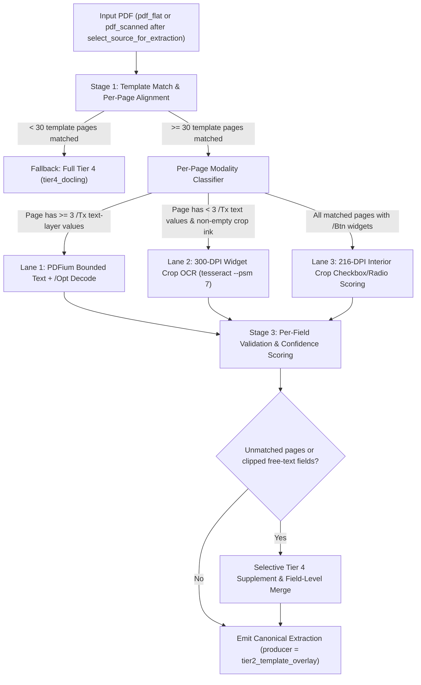

# PRD 038: Template Overlay Extraction for Flattened Official CDS PDFs

**Status**: Draft
**Created**: 2026-11-09
**Author**: Antigravity
**Related**: [ADR 0006 — Schema Build Architecture](../adr/0006-schema-build-architecture.md), [ADR 0007 — Extraction Architecture](../adr/0007-extraction-architecture.md), [PRD 005 — Extraction Worker Infrastructure](005-extraction-worker-infrastructure.md), [PRD 006 — Tier 1/2 Extraction Validation](006-tier1-tier2-extraction-validation.md), [PRD 0111A — Tier 4 PDF Cleaning Pipeline](0111a-tier4-pdf-cleaning-pipeline.md), [PRD 014 — Extraction Quality Pipeline](014-extraction-quality-pipeline.md)

---

## Context

Each year, the Common Data Set Initiative distributes an official fillable Adobe Acrobat PDF template (`50` pages across `2023-24`, `2024-25`, and `2025-26`, with `1,089` named AcroForm fields / `1,263` widget annotations in `2025-26`, `1,116` fields in `2024-25`, and `1,086` fields in `2023-24`).

When an institution publishes that PDF with its `/AcroForm` dictionary intact, `tools/tier2_extractor` (`producer = "tier2_acroform"`) reads exact `/V` field values and maps every widget's `pdf_tag` directly to its canonical CDS `question_number` via `schemas/cds_YYYY_YY.json`. When an institution fills out the exact same 50-page Adobe form and exports it via "Print to PDF", "Save as Flattened PDF", or a server-side PDF flattener (`PDFium`, `Adobe Acrobat / Distiller`, `Microsoft: Print To PDF`, `pdf-lib`), the `/AcroForm` widget tree is stripped and our format router (`detect_format` in `tools/extraction_worker/worker.py`) classifies the document as `pdf_flat` or `pdf_scanned`, sending it to Tier 4 (`tier4_docling`: Docling layout conversion + section slicing + `claude-haiku-4-5` cleaning).

Because the official 50-page Adobe PDF template renders form inputs as hundreds of small floating boxes rather than clean HTML/Word tables, Docling frequently drops multi-column numeric blocks, loses checkbox states (`☐`/`☒`), or fails section header detection entirely when the flattener corrupts bold heading font CMaps or converts filled values into vector outlines. Yet the visual coordinates of every field on the 50 template pages are still fixed to sub-point precision.

This PRD specifies **Template Overlay Extraction (`tier2_template_overlay`)**—a deterministic coordinate-guided extraction tier between Tier 2 (`tier2_acroform`) and Tier 4 (`tier4_docling`) that harvests each template year's AcroForm widget geometry from any fillable PDF of that year, aligns each page of a flattened official-template PDF, and extracts text-layer characters, rendered checkbox states, and (for vector-outlined `Microsoft: Print To PDF` files) high-DPI per-widget crop OCR directly into canonical CDS fields.

---

## Problem (Measured Corpus Sizing)

### 1. Corpus-Wide Extraction Gap (`cds_selected_extraction_result`, read-only production query)

Across `2025-26`, `2024-25`, and `2023-24`, Tier 4 (`tier4_docling`) recovers roughly 150–400 fewer fields per document than Tier 2 (`tier2_acroform`), and the gap is widest on flattened 50-page Adobe template PDFs:

| Canonical Year | Producer | Selected Docs (`cds_selected_extraction_result`) | Median Base Fields | Mean Base Fields | Min / Max Fields | Median Page Count |
|---|---|---:|---:|---:|---:|---:|
| **2025-26** | `tier1_xlsx` | 40 | 674.0 | 635.8 | 212 / 814 | — |
| **2025-26** | `tier2_acroform` | 60 | **674.5** *(686 prior snapshot)* | 667.8 | 510 / 818 | 50 |
| **2025-26** | `tier4_docling` (all) | 179 *(196 prior snapshot)* | **503.0** *(498 prior snapshot)* | 457.2 | 12 / 776 | 39 |
| **2024-25** | `tier1_xlsx` | 51 | 137.0 | 288.2 | 35 / 801 | — |
| **2024-25** | `tier2_acroform` | 83 | **534.0** *(536 prior snapshot)* | 512.7 | 112 / 780 | 50 |
| **2024-25** | `tier4_docling` (all) | 369 | **499.0** *(497 prior snapshot)* | 450.1 | 3 / 812 | 36 |
| **2023-24** | `tier2_acroform` | 20 | **610.0** | 586.0 | 456 / 748 | 50 |
| **2023-24** | `tier4_docling` (all) | 400 | **212.5** | 294.8 | 1 / 734 | 34 |

### 2. Sizing the Flattened Official-Template Cohort (`pages BETWEEN 48 AND 55` + Template Anchors)

 Tier 4 PDFs split into two distinct structural families:
1. **Excel/Word-exported PDFs (`28–47` pages):** Exported from the official Excel template (`templates/CDS_YYYY-YYYY_Excel_Template.xlsx`) or institutional Word templates. Docling handles their grid tables comparatively well (`2025-26` median **534** fields across 96 docs; `2024-25` median **538** fields across 219 docs).
2. **Flattened Official Adobe Form Template PDFs (`48–55` pages, centered on `50` pages):** Exported from the 50-page Adobe AcroForm template (identifiable by page count `48–55` and the Adobe-template-only page-1 banner `"Welcome to the YYYY-YYYY Common Data Set collection!"` plus section anchor phrases). On this cohort, **Tier 4 collapses to a median of 283 fields in 2025-26 and 354.5 fields in 2024-25**:

| Canonical Year | Tier 4 Docs in `48–55p` Cohort (% of Tier 4) | Exact `50p` / `51p` Docs | Match Official Template Anchors | Median Base Fields (Selected) | Mean Base Fields | Min / Max Fields | Docs `< 350` Fields | Docs `< 200` Fields |
|---|---:|---:|---:|---:|---:|---:|---:|---:|
| **2025-26** | **42 / 179 (23.5%)** *(43 by latest artifact)* | 27 / 2 | **42 / 42 (100%)** | **283.0** *(283.0)* | 289.5 | 64 / 647 | **33 (78.6%)** | **12 (28.6%)** |
| **2024-25** | **84 / 369 (22.8%)** *(85 by latest artifact)* | 48 / 2 | **84 / 84 (100%)** | **354.5** *(348.5)* | 329.0 | 85 / 577 | **40 (47.6%)** | **22 (26.2%)** |
| **2023-24** | **59 / 400 (14.8%)** | 28 / 2 | **55 / 59 (93.2%)** | **197.0** *(197.0)* | 235.5 | 51 / 620 | **45 (76.3%)** | **30 (50.8%)** |
| **Total (`24-25` + `25-26`)** | **126 docs** *(128 by latest artifact)* | 75 / 4 | **126 / 126 (100%)** | — | — | 64 / 647 | **73 (57.9%)** | **34 (27.0%)** |
| **Total (`23-24` – `25-26`)** | **185 docs** | 103 / 6 | **181 / 185 (97.8%)** | — | — | 51 / 647 | **118 (63.8%)** | **64 (34.6%)** |

### 3. Breakdown by Flattening Producer (`source_producer`) Within the `48–55` Page Cohort

Inspecting `cds_artifacts.metadata->>'source_producer'` on the `126` (`2024-25` + `2025-26`) flattened-template documents reveals **two distinct technical failure modes**:

| Canonical Year | `source_producer` Family | Flattened-Template Docs (`48–55p`) | Median Tier 4 Fields | Mean Tier 4 Fields | Min / Max Fields | Underlying Failure Mechanism in Tier 4 |
|---|---|---:|---:|---:|---:|---|
| **2025-26** | `Adobe Acrobat / Distiller` | 26 | **291.0** | 315.6 | 144 / 647 | Preserves filled text in PDF text layer at exact widget rects, but floating box layout + `Acrobat Distiller 26.0` bold-font CMap corruption (`"&RPPRQ 'DWD 6HW"` Caesar-shifted bytes) breaks Docling section headers and table pairing |
| **2025-26** | `Microsoft: Print To PDF` | 13 | **139.0** | 195.2 | 64 / 539 | Converts all filled form values and bold headers into **vector path outlines** (`m`/`l`/`c`/`f` operators); PDF text layer contains only regular-weight prompt labels (`2/204` values in text on Miami) |
| **2025-26** | `null / other` (incl. `PDFium`) | 3 | **531.0** | 459.0 | 313 / 535 | Preserves filled text in PDF text layer (`PDFium`), but Docling drops checkbox grids (`A1`, `C7`, `E`, `F`), misaligned multi-column tables (`B1`, `D`, `H5`, `J`), and mis-pairs rows |
| **2024-25** | `Adobe Acrobat / Distiller` | 36 | **412.5** | 396.4 | 132 / 577 | Same floating-box / CMap header loss as `2025-26` |
| **2024-25** | `Microsoft: Print To PDF` | 21 | **136.0** | 167.9 | 85 / 516 | Same vector-path value conversion as `2025-26` |
| **2024-25** | `PDFium / Chromium` | 2 | **202.5** | 202.5 | 134 / 271 | Text layer intact; Docling drops sections and mis-pairs columns |
| **2024-25** | `pdf-lib` / `iLovePDF` | 2 | **203.5** | 203.5 | 143 / 264 | Text layer intact; Docling drops sections |
| **2024-25** | `null / other` | 23 | **355.0** | 384.2 | 126 / 546 | Mixed text-layer flatteners |

Concrete examples in the current `2025-26` corpus:
- **Valparaiso University (`2025-26`):** Published fillable (`80475b8f*`, Tier 2 = **621** canonical fields / `624` with derived `B.1`), then re-published flattened via `PDFium` (`5969b8e6*`). Even though `86/87` multi-digit numbers remain in the PDF text layer, Tier 4 extracts only **313** fields, completely misses sections `A1`, `B1`, `D`, `E`, `H5`, and `J`, and **disagrees with Tier 2 on 144 of 303 shared fields**.
- **Barnard College (`2025-26`):** Published fillable (`388e875e*`, Tier 2 = **652** fields / `609` non-`/Off`), then re-published flattened via `PDFium` (`35f9ba1b*`) -> Tier 4 drops to **319** fields.
- **University of Miami (`2025-26`):** Published fillable (`b61624de*`, Tier 2 = **758** fields / `761` with derived `B.1`), then re-published via `Microsoft: Print To PDF` (`eaed9690*`, 52 pages with a 2-page prepended cover + TOC) where filled values are vector paths (`2/204` multi-digit values in the text layer). Tier 4 extracts only **137–156** fields (even with forced Docling OCR at `images_scale=1.0`).
- **Schools with no prior fillable PDF in `cds_artifacts`:** Wittenberg (`64` fields, `Microsoft: Print To PDF`), Art Center College of Design (`74` fields, `Microsoft: Print To PDF`), SUNY Potsdam (`116` fields), Lake Superior State (`117` fields), UCCS (`131` fields), Siena (`133` fields), University of Arizona (`139` fields), Marquette (`144` fields), Ohio State (`148` fields), Rhode Island College (`228` fields, `Acrobat`), Caltech (`243` fields, `Acrobat Distiller 26.0`), and Tufts (`251` fields, `Acrobat Distiller 26.0`).

---

## Read-Only Prototype Results (Spike Validation)

To validate feasibility and measure real-world accuracy before writing production code, we built a read-only prototype in `scratch/prd038/` using `pypdf`, `pypdfium2`, `Pillow`, and `tesseract` against actual `2025-26` source PDFs.

### 1. Cross-School Field-Map Portability & Page Alignment Audit

We harvested the full AcroForm widget map (`1,089` fields, `1,263` widget annotations across `50` pages: `747` `/Tx` text/numeric widgets, `39` `/Ch` dropdown widgets with `/Opt` `[export_code, display_label]` pairs, and `477` `/Btn` checkbox/radio widgets across `303` fields) from:
1. The blank `2025-26` official template (`CDS-PDF-2025-2026_PDF_Template.pdf`),
2. Valparaiso's fillable PDF (`80475b8f*`, `50` pages),
3. Barnard's fillable PDF (`388e875e*`, `50` pages), and
4. University of Miami's fillable PDF (`b61624de*`, `52` pages).

**Key geometry & alignment findings (reported honestly):**
- **Widget coordinates are portable across schools:** After subtracting Miami's `+2` page offset, **1,261 of 1,263 widget rectangles (`99.84%`) across the blank template, Valparaiso, Barnard, and Miami match within `< 0.5 pt`** on standard US Letter pages (`mediabox = [0, 0, 612, 792]`).
- **Inverted `/Rect` coordinates in the official Adobe template:** Exactly **114 of 1,263 widgets (`9.0%`)** in the official `2025-26` template store inverted vertical bounds (`y0 > y1`, e.g., `AP_RECD_1ST_WMN_N` has `/Rect [448.79, 372.77, 510.66, 355.05]`). Normalizing every harvested rectangle to `[min(x0, x1), min(y0, y1), max(x0, x1), max(y0, y1)]` is mandatory; without normalization, Valparaiso text-in-rect recovery drops from `98.0%` to `56.8%`.
- **Within-page alignment (`dx, dy, sx, sy`) vs. Page-index alignment (`page_offset`):** We measured both page-index alignment and within-page character-box offsets across 7 flattened `2025-26` school PDFs spanning all three producer families:

| School (`2025-26` Flattened PDF) | `source_producer` | Page Count | Matched Template Pages | Page Index Offset (`target_p - tpl_p`) | Within-Page Median `(dx, dy)` | Within-Page `p90 (|dx|, |dy|)` | Within-Page Scale `(sx, sy)` | Alignment Notes |
|---|---|---:|---:|---|---|---|---:|---|
| **Valparaiso** (`5969b8e6*`) | `PDFium` | 50 | 50 / 50 | **`0`** (all 50 pages) | `(0.00pt, 0.00pt)` | `(0.00pt, 0.00pt)` | `(1.000, 1.000)` | Exact 1:1 page & coordinate match |
| **Barnard** (`35f9ba1b*`) | `PDFium` | 50 | 50 / 50 | **`0`** (all 50 pages) | `(0.00pt, 0.00pt)` | `(0.00pt, 0.00pt)` | `(1.000, 1.000)` | Exact 1:1 page & coordinate match |
| **Univ. of Miami** (`eaed9690*`) | `Microsoft: Print To PDF` | **52** | 50 / 50 | **`+2`** (`target p2..51 -> tpl p0..49`) | `(0.00pt, 0.00pt)` | `(0.09pt, 0.10pt)` | `(1.000, 1.000)` | Prepended 2-page cover + Table of Contents |
| **Marquette** (`marquette_2025-26`) | `Microsoft: Print To PDF` | **51** | 50 / 50 | **`+1`** (`target p1..50 -> tpl p0..49`) | `(0.00pt, 0.00pt)` | `(0.09pt, 0.10pt)` | `(1.000, 1.000)` | Prepended 1-page cover sheet |
| **Wittenberg** (`wittenberg_2025-26`) | `Microsoft: Print To PDF` | **49** | 49 / 50 | **`0` then `-1`** | `(0.00pt, 0.00pt)` | `(0.09pt, 0.10pt)` | `(1.000, 1.000)` | Dropped 1 template page mid-packet |
| **Caltech** (`caltech_2025-26`) | `Acrobat Distiller 26.0` | 50 | 50 / 50 | **`0`** (all 50 pages) | `(0.00pt, 0.00pt)` | `(0.01pt, 0.01pt)` | `(1.000, 1.000)` | Bold headings have garbled `/ToUnicode` CMap; regular-font anchors & cell rects align at `(0, 0)` |
| **Tufts** (`tufts_2025-26`) | `Acrobat Distiller 26.0` | **48** | 48 / 50 | **`-2`** (`target p0..47 -> tpl p2..49`) | `(0.00pt, 0.00pt)` | `(0.01pt, 0.01pt)` | `(1.000, 1.000)` | Omitted first 2 intro/instruction pages (`tpl p0..1`); bold headings garbled, cell rects at `(0, 0)` |

> **Honest alignment takeaway:** Within-page widget coordinates `(dx, dy, sx, sy)` do **not** drift across schools (`|dx|, |dy| <= 0.10 pt` across `PDFium`, `Microsoft: Print To PDF`, and `Acrobat Distiller`). However, **page numbers DO shift across schools** (`-2` to `+2` pages due to prepended covers/TOCs or omitted intro pages), and `Acrobat Distiller 26.0` corrupts bold-font `/ToUnicode` maps. Therefore, page alignment must match **regular-weight body prompt anchors** per page rather than assuming `target_page == template_page` or matching bold section headers.

### 2. Text-in-Rect + Checkbox Recovery on Valparaiso & Barnard (`PDFium` Flattened vs. Tier 2 Ground Truth)

Using `tp.get_text_bounded(x0 - 1, y0 - 1, x1 + 1, y1 + 1)` for `/Tx` and `/Ch` fields (with `/Opt` display-to-export decoding and numeric/currency/percent normalization) plus 216-DPI interior crop ink scoring for `/Btn` checkboxes and radio buttons, we compared our prototype output on the flattened PDFs against each school's own Tier 2 fillable extraction—testing both **self-harvested maps** and **cross-school maps harvested from University of Miami**:

| Benchmark Pair (`2025-26`) | Field Map Source | `/Tx` Text/Numeric Match | `/Ch` Dropdown Match (with `/Opt` Map) | `/Btn` Checkbox & Radio Match | Derived `B.1` Totals | **Total Tier 2 Value Recovery** | Current `tier4_docling` Fields |
|---|---|---|---|---|---|---|---|
| **Valparaiso Flattened** (`5969b8e6*`) vs. Valparaiso Tier 2 (`80475b8f*`, `624` fields) | **Valparaiso fillable** (self) | **451 / 460 (98.0%)** *(273 raw unformatted)* | **21 / 22 (95.5%)** *(14 without `/Opt`)* | **139 / 139 (100.0%)** *(86 single + 53 radio)* | **3 / 3 (100%)** | **614 / 624 (98.4%)** | **313** *(144/303 shared disagree)* |
| **Valparaiso Flattened** (`5969b8e6*`) vs. Valparaiso Tier 2 (`80475b8f*`, `624` fields) | **Miami fillable** (cross-school, `-2p` offset) | **451 / 460 (98.0%)** | **21 / 22 (95.5%)** | **139 / 139 (100.0%)** | **3 / 3 (100%)** | **614 / 624 (98.4%)** | **313** |
| **Valparaiso Flattened** (`5969b8e6*`) vs. Valparaiso Tier 2 (`80475b8f*`, `624` fields) | **Official Blank Template** | **451 / 460 (98.0%)** | **21 / 22 (95.5%)** | **139 / 139 (100.0%)** | **3 / 3 (100%)** | **614 / 624 (98.4%)** | **313** |
| **Barnard Flattened** (`35f9ba1b*`) vs. Barnard Tier 2 (`388e875e*`, `609` non-`/Off` fields) | **Miami fillable** (cross-school) or **Barnard self** | **435 / 458 (95.0%)** *(19 display-rounded decimals)* | **14 / 14 (100.0%)** | **134 / 134 (100.0%)** | **3 / 3 (100%)** | **586 / 609 (96.2%)** | **319** |

**Accounting for every single non-matching field on Valparaiso (`10 / 624` fields):**
1. **2 hidden zero-valued C9 checker fields (`C.938 SAT_VERB_CHECKER`, `C.945 SAT_MATH_CHECKER`):** Tier 2 has `'0'` in `/V`, but the template suppresses rendering `'0'` in the C9 validation-checker box when flattened.
2. **2 display-rounded decimals (`B.2203` retention `77.2` -> `'77'`, `I.203` FTE faculty `203.3` -> `'203'`):** Adobe's field appearance stream formatted the raw `/V` float as an integer when generating the flattened text appearance. (On Barnard, `19 / 23` misses are this exact phenomenon: e.g., `0.923` rendered as `92%` / `0.92`).
3. **5 long multi-line text strings clipped by the non-scrolling widget box (`D.1701`, `D.2201`, `E.314`, `F.302`, `F.414`):** Match the first 80–350 characters of Tier 2 exactly, then clip at the bottom of the widget rectangle.
4. **1 genuine correction between editions (`A.106 STATE_CODE`):** Valparaiso's fillable PDF had typo `'IL'` (Illinois), which Valparaiso corrected to `'Indiana'` (`'IN'`) before flattening!

### 3. High-DPI Crop OCR + Checkbox Recovery on University of Miami (`Microsoft: Print To PDF` Vector Paths)

On University of Miami's flattened PDF (`eaed9690*`, 52 pages), filled values are drawn as vector paths (`0` text chars inside `99%` of `/Tx` rects). We tested:
1. **Full-document `/Btn` checkbox/radio detection** across all 50 matched template pages via 216-DPI interior crop ink density (`25%` inner margin inset), and
2. **300-DPI per-widget crop OCR (`tesseract stdin stdout --psm 7`)** across **5 representative numeric-heavy pages** (`169` populated Tier 2 `/Tx` fields total), cropping each widget rect with a `1.2 pt` border inset, `16 px` white padding, an ink-presence gate (`(gray < 200).mean() >= 0.005` to skip blank cells without calling Tesseract), and a numeric character whitelist (`0123456789.,$%-`) for numeric/currency/percent fields:

| Miami `2025-26` Flattened Page / Cohort | Template Page -> Miami Page | Populated Tier 2 Fields | Exact Raw String Match | **Normalized Value Match** | Blank-Cell False Positives | Notes |
|---|---|---:|---:|---:|---:|---|
| **All `/Btn` Checkboxes & Radios (Full Doc)** | `tpl p0..49 -> miami p2..51` | **152** | **152 / 152 (100.0%)** | **152 / 152 (100.0%)** | 1 (`C.207` static box border overlap, fixed by border-pixel mask) | Every single checkbox and radio button across all 50 pages recovered |
| **Section B1: Enrollment Grid** (`/Tx`) | `tpl p5 -> miami p7` | **64** | 64 / 64 (100.0%) | **64 / 64 (100.0%)** | 0 / 0 | 64 of 64 multi-column enrollment cells recovered exactly |
| **Section C1: First-Time Admission** (`/Tx`) | `tpl p13 -> miami p15` | **15** | 15 / 15 (100.0%) | **15 / 15 (100.0%)** | 0 / 5 | All 15 applicant/admit/enrolled counts recovered; all 5 blank cells skipped cleanly |
| **Section C9: SAT/ACT Score Percentiles** (`/Tx`) | `tpl p19 -> miami p21` | **31** | 29 / 31 (93.5%) | **31 / 31 (100.0%)** | 0 / 0 | 2 fields formatted with `%` visually (`98%` vs `98`) |
| **Section H1: Financial Aid Part 1** (`/Tx`) | `tpl p32 -> miami p34` | **19** | 0 / 19 *(visual `$` + `,`)* | **19 / 19 (100.0%)** | 0 / 0 | All 19 currency amounts (`$179,662,882`, etc.) match Tier 2 to the dollar |
| **Section H1/H2: Financial Aid Part 2** (`/Tx`) | `tpl p33 -> miami p35` | **40** | 14 / 40 *(visual `$` + `,`)* | **39 / 40 (97.5%)** exact float; **40 / 40 (100.0%)** at 2 decimals | 0 / 0 | Only diff is `H.115 NB_WAIVER_D`: Tier 2 `/V` has IEEE float `'13424825.8799999'`, crop OCR reads `'$13424825.88'` |
| **Total Across 5 Miami Pages (`/Tx`)** | 5 pages (`p7, p15, p21, p34, p35`) | **169** | 122 / 169 (72.2%) | **168 / 169 (99.4%)** exact; **169 / 169 (100.0%)** at `0.01` precision | **0 / 5 (0.0%)** | Runs in `~1.1s / page` (`~6s` total for 169 crops via in-memory `stdin` pipe) |

---

## Goals

1. **Recover Tier 2-grade field counts and accuracy on flattened official-template PDFs:** Achieve **`>= 95%` field recovery** on text-layer flattened official-template PDFs (`PDFium`, `Adobe Acrobat / Distiller`, `pdf-lib`) and **`>= 90%` numeric/checkbox field recovery** on vector-path flattened official-template PDFs (`Microsoft: Print To PDF`), raising the `2025-26` flattened-template cohort median from **283 fields to `>= 580` fields** and `2024-25` from **354.5 fields to `>= 500` fields**.
2. **Commit versioned, portable field maps in-repo for `2023-24`, `2024-25`, and `2025-26`:** Store deterministic widget maps in `schemas/field_maps/cds_pdf_field_map_YYYY_YY.json` harvested from official templates or verified multi-school `tier2_acroform` consensus (since `templates/` only stores `.xlsx` files for `2024-25` and `2025-26`).
3. **Handle per-page offset shifts (`-2` to `+2` pages) and CMap-corrupted bold headers automatically:** Align each target page against the 50 template pages using regular-weight prompt anchor phrases and monotonic dynamic programming, then compute per-page `(dx, dy, sx, sy)` affine adjustments.
4. **Integrate cleanly with the companion flattened-reprint source guard, Tier 4 fallback, and regression guards:** Establish explicit producer precedence (`tier2_template_overlay`), per-field confidence scoring, section/field merge rules with `tier4_docling`, and compatibility with `is_field_regression`.

## Non-Goals (What Is Not Attempted)

1. **Excel-rendered or custom institutional layout PDFs (`28–47` pages or `< 30` matched template pages):** PDFs exported from the Excel template (`templates/CDS_YYYY-YYYY_Excel_Template.xlsx`) or custom university factbook layouts have variable row heights and page breaks. They will fail the template-match gate in `< 50 ms` and continue routing to `tier4_docling`.
2. **Recovering text overflow clipped outside fixed non-scrolling widget boundaries:** When a school pastes a 1,000-character essay into a 3-line fixed `/Tx` box and flattens the PDF, characters below the widget bottom edge are not rendered in the PDF stream or page bitmap. When our clip detector flags bottom/right-edge truncation and Tier 4 extracted the full unclipped paragraph, the merge policy defers that specific free-text field to Tier 4; otherwise it records the visible prefix with `confidence = "low"`.
3. **Handwritten or low-resolution crooked flatbed scans (`< 150 DPI` or skew `> 3°`):** Crop OCR targets digital vector-path flatteners (`Microsoft: Print To PDF`) and clean rasterizations of the official Adobe template, not skewed camera scans.
4. **Full-page OCR via Tesseract:** We only crop and OCR individual populated widget rectangles (`~15–65` small crops per page on vector-path pages), never full pages.

---

## Design

### Architecture Overview



### 1. Versioned Field Maps (`schemas/field_maps/cds_pdf_field_map_YYYY_YY.json`)

Because `templates/` only contains `.xlsx` files for `2024-25` and `2025-26`, we add a deterministic build CLI (`tools/tier2_extractor/build_field_map.py`) that harvests the AcroForm widget geometry from either:
- An official blank PDF template (available for `2023-24` and `2025-26`), or
- A consensus of `>= 3` `tier2_acroform` school PDFs for that year (e.g., `2024-25`: Fitchburg State `25008b74*`, Amherst, and Clemson), verifying that every widget's page-relative normalized `/Rect` agrees across all donor PDFs within `<= 0.5 pt` before writing the map.

Each committed JSON artifact (`schemas/field_maps/cds_pdf_field_map_2023_24.json`, `..._2024_25.json`, `..._2025_26.json`) has the following schema:

```json
{
  "schema_version": "1.0.0",
  "cds_year": "2025-26",
  "template_page_count": 50,
  "mediabox": [0.0, 0.0, 612.0, 792.0],
  "source_donors": ["CDS-PDF-2025-2026_PDF_Template.pdf", "valparaiso-2025-26", "miami-2025-26"],
  "pages": [
    {
      "template_page": 0,
      "section": "intro",
      "anchors": [
        {"text": "Welcome to the 2025-2026 Common Data Set collection!", "bbox": [54.0, 668.2, 342.1, 678.5]},
        {"text": "The Common Data Set (CDS) initiative is a collaborative effort", "bbox": [54.0, 636.0, 389.4, 646.2]}
      ]
    }
  ],
  "fields": [
    {
      "question_number": "C.101",
      "pdf_tag": "AP_RECD_1ST_MEN_N",
      "section": "C",
      "ft": "/Tx",
      "value_type": "integer",
      "is_hidden_checker": false,
      "widgets": [
        {"template_page": 13, "rect": [376.43, 355.05, 439.96, 372.77]}
      ]
    },
    {
      "question_number": "A.106",
      "pdf_tag": "STATE_CODE",
      "section": "A",
      "ft": "/Ch",
      "value_type": "enum",
      "opt_map": {"Indiana": "IN", "IN": "IN", "Illinois": "IL", "IL": "IL"},
      "widgets": [
        {"template_page": 2, "rect": [149.76, 400.28, 356.71, 415.72]}
      ]
    },
    {
      "question_number": "A.201",
      "pdf_tag": "INST_CONTROL",
      "section": "A",
      "ft": "/Btn",
      "value_type": "enum",
      "value_options": {"1": "Public", "2": "Private (nonprofit)", "3": "Proprietary"},
      "widgets": [
        {"template_page": 2, "rect": [174.12, 240.31, 185.79, 251.55], "on_state": "/1", "has_static_box_overlap": false},
        {"template_page": 2, "rect": [174.12, 223.95, 185.79, 235.19], "on_state": "/2", "has_static_box_overlap": false},
        {"template_page": 2, "rect": [174.12, 207.01, 185.79, 218.25], "on_state": "/3", "has_static_box_overlap": false}
      ]
    }
  ]
}
```

**Harvesting invariants enforced by `build_field_map.py`:**
1. **Rectangle normalization:** Every `/Rect` is normalized to `[min(x0, x1), min(y0, y1), max(x0, y1_or_y0)]` so the 114 inverted-`y` widgets in the Adobe template are corrected once at build time.
2. **Regular-font anchor selection:** Each template page stores `8–12` distinct `>= 18`-character prompt phrases drawn in the template's regular body font (never bold section headers, which `Acrobat Distiller 26.0` corrupts via missing `/ToUnicode` CMaps), along with their template bounding boxes.
3. **Dropdown `/Opt` preservation:** For all `/Ch` widgets, both the export code and display string from `/Opt` are stored in `opt_map` so flattened display strings (`"Indiana"`, `"per credit"`, `"4-1-4"`) decode to canonical Tier 2 export codes (`"IN"`, `"C"`, `"4"`).
4. **Static-border overlap flag:** Widgets whose rectangle overlaps a static printed `☐` glyph in the blank template (specifically `C.207 WAITLIST_INFO_SCH` in `2025-26`) are flagged with `has_static_box_overlap: true` so Lane 3 uses a tighter `35%` center-core inset instead of `25%`.

### 2. Stage 1 — Template Detection & Per-Page Alignment

Given a candidate PDF (`pdf_flat` or `pdf_scanned`):
1. **Fast page-count pre-filter:** Reject immediately if `page_count < 40` or `page_count > 65` (allows up to 10 dropped template pages or 15 prepended/appended cover/appendix pages while immediately skipping 1-page summaries, 32-page Excel printouts, and 200-page factbooks).
2. **Per-page anchor matching & monotonic DP alignment:**
   - Extract normalized text on each target page `q in [0 .. Q-1]`.
   - Score each `(target_page q, template_page p)` pair by the fraction of `pages[p].anchors` found on page `q`.
   - Solve a monotonic dynamic program (`p` strictly increasing with `q`) assigning each target page `q` to either a unique `template_page p in [0 .. 49]` (when anchor match `>= 0.50`, or interpolated between adjacent exact matches `q-1 -> p-1` and `q+1 -> p+1`) or `unmatched` (cover page, TOC, appendix).
   - **Gate:** Require **`>= 30` matched template pages** (out of 50) to classify the PDF as an official Adobe template document. Otherwise return `not_official_pdf_template` and fall back to Tier 4.
3. **Per-page coordinate transform `(dx, dy, sx, sy)`:**
   - Normalize page mediabox scaling `(sx, sy) = (target_width / 612.0, target_height / 792.0)`.
   - For each matched page, locate the `pypdfium2` character bounding boxes of matched regular-font anchor phrases and take the median offset `dx = median(x_target - sx * x_tpl)`, `dy = median(y_target - sy * y_tpl)`.
   - Clamp to `(0.0, 0.0)` when `|dx| < 0.25 pt` and `|dy| < 0.25 pt` (which holds across all 7 tested schools) or when `< 3` anchor charboxes resolve cleanly on that page.
   - Transform every widget rectangle `[x0, y0, x1, y1]` on template page `p` to target page `q`:
     `[sx * x0 + dx, sy * y0 + dy, sx * x1 + dx, sy * y1 + dy]`.

### 3. Stage 2 — Per-Field Extraction Lanes

#### Lane 1: Text-Layer Bounded Extraction (`/Tx` and `/Ch` on text-preserving flatteners)
- For each `/Tx` or `/Ch` widget on a matched page, query `textpage.get_text_bounded(x0 - 1.0, y0 - 1.0, x1 + 1.0, y1 + 1.0)`.
- Clean control characters (`\x00`–`\x1f`), normalize whitespace, and strip display-only formatting according to `value_type`:
  - `integer` / `number` / `currency` / `percent`: strip leading `$`, thousands commas `,`, trailing `%`, and redundant `.00` on integer-typed fields (`"$45,120"` -> `"45120"`, `"16.00"` -> `"16"`).
  - `/Ch` dropdowns: look up the extracted display label in `field.opt_map` (case-insensitive, whitespace-normalized) to emit the canonical export code (`"Indiana"` -> `"IN"`).

#### Lane 2: High-DPI Widget Crop OCR (`/Tx` and `/Ch` on `Microsoft: Print To PDF` vector-path pages)
- **Trigger condition:** A matched template page has `>= 5` `/Tx` widgets in the field map, `< 3` non-empty text-layer `/Tx` reads in Lane 1, and at least one `/Tx` widget interior has dark pixels (`ink_ratio >= 0.005`).
- **Execution:**
  1. Render the page **once** via `page.render(scale=300/72).to_pil().convert("L")`.
  2. For each `/Tx` or `/Ch` widget, crop the interior with a `1.2 pt` inset on all 4 sides (to exclude the printed box border).
  3. **Empty-box ink gate:** Compute `ink_ratio = (crop_array < 200).mean()`. If `ink_ratio < 0.005`, the field is blank—skip OCR immediately (`0 ms`).
  4. **In-memory Tesseract call:** Pad the crop with `16 px` of white (`255`) border, encode as PNG in a `BytesIO` buffer, and pipe via `stdin` to `tesseract stdin stdout --psm 7` (`--psm 6` for multi-line text rects where `height > 28 pt`). For numeric/integer/currency/percent fields, pass `-c tessedit_char_whitelist=0123456789.,$%-`.
  5. Apply the same type normalization and `/Opt` lookup as Lane 1.

#### Lane 3: Rendered Checkbox & Radio Button Detection (`/Btn` across all matched pages)
- Because flatteners frequently render checkmarks as vector paths (`Microsoft: Print To PDF`), X-marks, or Wingdings/ZapfDingbats symbols lacking Unicode mappings, `/Btn` detection always inspects the rendered page bitmap (`216 DPI`, or reuses the `300 DPI` bitmap from Lane 2):
  1. Crop each `/Btn` widget rectangle with an interior margin inset of **`25%`** (`35%` if `has_static_box_overlap == true`) so the outer square/circle border is excluded.
  2. Compute interior ink density `score = (255.0 - crop_array.mean()) / 255.0`.
  3. **Single-widget checkbox (`len(widgets) == 1`):** Checked if `score >= 0.12`; otherwise omitted (`/Off`, matching Tier 2's omission of unchecked fields).
  4. **Multi-widget radio group (`len(widgets) >= 2`):** Sort widgets by `score` descending. Select the top widget's `on_state` (stripped of leading `/` and trailing whitespace) if `best_score >= 0.12` and `best_score - second_score >= 0.08`, then decode via `decode_button_value(pdf_tag, raw_code, value_options)` from `tools/schema_builder/decode_checkboxes.py`.

#### Post-Processing
- Run `apply_b1_derived_all_totals(extracted_fields)` from `tools/tier2_extractor/extract.py` to populate derived `B.1` "All" columns (`B.115`, `B.116`, `B.129`, etc.) identically to Tier 2.

### 4. Stage 3 — Validation, Per-Field Confidence, and Tier 4 Fallback / Merge Rules

#### How Fields Are Validated & Scored
Every extracted field receives a deterministic validation check and confidence score (`0.0–1.0`, bucketed into `high` `>= 0.95`, `medium` `0.80–0.94`, `low` `< 0.80`):
1. **Type & range validation:**
   - `integer`: must parse as an integer after stripping `$`, `,`, `.00`.
   - `number` / `currency`: must parse as a finite float `>= 0`.
   - `percent`: must parse as a float in `[0.0, 100.0]` (or `[0.0, 1.0]`).
   - `/Ch` & `/Btn`: must resolve to a valid code or label in `opt_map` / `value_options`.
   - Any value failing type validation is discarded (not emitted) and logged in `diagnostics.rejected_fields`.
2. **Cross-field arithmetic validation (boosts crop-OCR confidence from `medium` to `high`):**
   - Section `B1` row totals (`men + women + another_gender == total`), Section `C1` (`admitted <= applied`, `enrolled <= admitted`), Section `C9` (`25th <= 50th <= 75th` percentile, sum of score bands `= 100%`), and Section `H2` counts (`awarded_aid <= need_determined <= applied_for_aid`).
3. **Visual clip detection on free-text `/Tx` boxes:**
   - On multi-line free-text fields (`value_type == "text"` and widget `height >= 30 pt`), if the last extracted character's right edge is within `4 pt` of `x1` and its baseline is within `6 pt` of `y0`, mark `clipped_suspect = True` and set `confidence = 0.65 ("low")`.

#### Fallback & Merge Rules with Tier 4 (`tier4_docling`)
1. **Whole-document fallback:** If Stage 1 matches `< 30` template pages, `tier2_template_overlay` exits cleanly without emitting an artifact, and `worker.py` runs `tier4_docling`.
2. **Unmatched pages / sections:** If a document matches `30–47` template pages (e.g., a school replaced Section J with a custom 2-page table), `tier2_template_overlay` extracts all matched template pages and optionally invokes Tier 4 cleaning **only on the unmatched non-cover pages** for sections missing `> 50%` of their expected fields.
3. **Field-level merge precedence (when combining Template Overlay with Tier 4 on unmatched sections or existing Tier 4 artifacts):**
   - For structured fields (`integer`, `number`, `currency`, `percent`, `enum`, `/Ch`, `/Btn`): **`tier2_template_overlay` (`high` or `medium` confidence) always wins over `tier4_docling`**. (On Valparaiso, Tier 4 disagreed with Tier 2 on 144 of 303 shared fields; Template Overlay agrees on 98.4%).
   - For free-text fields flagged `clipped_suspect = True` (`confidence = "low"`, e.g., `D.1701`, `E.314`): if a Tier 4 value exists for that `question_number`, starts with the same 30-character prefix, and is `>= 20%` longer, retain the unclipped Tier 4 string; otherwise keep the Template Overlay string.
   - For fields on unmatched pages where Template Overlay produced no value: retain `tier4_docling` values.

---

## Relationship to Companion Fix, Producer Versioning & Regression Guard

### 1. Relationship to the Companion Flattened-Reprint Source Guard (`santhonys/flattened-reprint-guard`)

A companion worker PR in `tools/extraction_worker/worker.py` (`select_source_for_extraction` / `compare_fillable_reprint_candidate`) addresses the case where a school **previously published a fillable PDF** for the same `document_id` and later re-uploaded a flattened reprint:
- When the latest `kind='source'` artifact is a fieldless PDF (`pdf_flat` / `pdf_scanned`) and an earlier `kind='source'` artifact for the same `document_id` has `>= 50` filled AcroForm fields and a page count within `±10%`, `compare_fillable_reprint_candidate` checks what fraction of `>= 4`-digit numeric values from the prior fillable PDF appear in the new PDF's text layer:
  1. `match_ratio >= 0.90` (`reason = "flattened_reprint_same_data"`): selects the earlier fillable source so Tier 2 (`tier2_acroform`) stays active (directly resolving Valparaiso `2025-26` and Barnard `2025-26`).
  2. `text_chars >= 100` and `match_ratio <= 0.10` (`reason = "print_to_pdf_values_missing_from_text"`): selects the earlier fillable source and sets `needs_review = True` (directly resolving University of Miami `2025-26`).
  3. `0.10 < match_ratio < 0.90` (`reason = "edition_values_changed"`): uses the new flattened PDF because the institution materially revised its numbers.

**How `tier2_template_overlay` (PRD 038) and the companion source guard compose:**
1. **The companion source guard runs first (`select_source_for_extraction`).** Whenever a valid prior fillable source exists with identical data, we use real Tier 2 (`tier2_acroform`) at zero OCR cost.
2. **Template Overlay covers the `126` current `2024-25` + `2025-26` (`185` including `2023-24`) flattened-template documents that have NO prior fillable source in `cds_artifacts`**—which is `> 95%` of the flattened-template cohort (e.g., Wittenberg, Art Center, Caltech, Tufts, Ohio State, Marquette, University of Arizona).
3. **Template Overlay covers `edition_values_changed` (`0.10 < match_ratio < 0.90`):** When a school genuinely updates its CDS numbers and publishes the revised edition as a flattened PDF, `select_source_for_extraction` rightly selects the new flattened PDF; `tier2_template_overlay` extracts `~600+` fields from that revised edition instead of plunging from Tier 2 (`~650` fields) to Tier 4 (`~283` fields).
4. **Template Overlay resolves `print_to_pdf_values_missing_from_text` (`needs_review`):** Running `tier2_template_overlay` on the vector-path reprint allows `compare_fillable_reprint_candidate` (or a follow-up verification pass) to compare actual crop-OCR numbers against the earlier fillable edition and clear `needs_review` automatically.

### 2. Producer Naming, Versioning & Database Precedence

- **Producer name:** `tier2_template_overlay`
- **Producer version:** `PRODUCER_VERSION = "0.1.0"` (stored in `tools/tier2_extractor/overlay.py`; bumped whenever field maps, crop-OCR normalization, or checkbox thresholds change).
- **Artifact metadata (`cds_artifacts.metadata`):**
  - `producer`: `"tier2_template_overlay"`
  - `producer_version`: `"0.1.0"`
  - `field_map_version`: `"1.0.0"`
  - `matched_template_pages`: integer (`30..50`)
  - `page_offset_summary`: e.g. `{"min": 2, "max": 2, "median": 2}`
  - `lane_counts`: `{"text_rect": 451, "crop_ocr": 0, "checkbox_crop": 139, "b1_derived": 3, "tier4_supplement": 0}`
  - `confidence_counts`: `{"high": 588, "medium": 21, "low": 5}`
- **Canonical selection precedence (`cds_selected_extraction_result` view & `extraction_ledger_tier`):**
  Update the SQL producer priority in `cds_selected_extraction_result` (building on `supabase/migrations/20260428153000_tier4_fallback_compatibility.sql`) so `tier2_template_overlay` ranks immediately below `tier2_acroform` and above `tier6_html` / `tier4_docling`:
  1. `tier1_xlsx` (`priority = 1`)
  2. `tier2_acroform` (`priority = 2`)
  3. **`tier2_template_overlay` (`priority = 3`)**
  4. `tier6_html` (`priority = 4`)
  5. `tier4_docling` (`priority = 5`)

### 3. Interaction with Tier 4 Regression Guard (`is_field_regression`)

`tools/extraction_worker/worker.py` enforces `is_field_regression(previous_fields, new_fields)` (`MIN_FIELDS_FOR_REGRESSION_GUARD = 100`, `MIN_REEXTRACT_FIELD_RATIO = 0.60`), which blocks a re-extraction of the same `source_sha256` from replacing a previous canonical artifact if `new_fields < previous_fields * 0.60`:
- Because `tier2_template_overlay` runs before `tier4_docling` on `pdf_flat` / `pdf_scanned` documents, its output is checked against `get_latest_canonical_extraction(sb, doc_id)` via `is_field_regression` before inserting `is_canonical = True`.
- Additionally, `tier2_template_overlay` enforces an internal **minimum yield floor of `250` validated fields** (or `>= previous_tier4_fields`, whichever is higher, whenever a prior `tier4_docling` artifact exists for the same `source_sha256`). If a flattened template is mostly blank or corrupted and yields fewer fields than an existing `tier4_docling` artifact, the worker either merges non-conflicting `tier4_docling` fields or falls back to `tier4_docling` so no document ever regresses in field count.

---

## Milestones

### M0: Harvest & Commit `2023-24`, `2024-25`, and `2025-26` Field Maps
- Implement `tools/tier2_extractor/build_field_map.py` to extract normalized `/Rect` coordinates, `/FT`, `/Opt` maps, `/AP /N` button states, and regular-font page anchors.
- Generate and commit `schemas/field_maps/cds_pdf_field_map_2023_24.json`, `cds_pdf_field_map_2024_25.json` (from multi-school `tier2_acroform` consensus), and `cds_pdf_field_map_2025_26.json`.
- Add unit tests verifying `1,089` fields (`2025-26`), `1,116` fields (`2024-25`), and `1,086` fields (`2023-24`), zero inverted rects (`x0 < x1` and `y0 < y1`), and `>= 8` regular-font anchors per template page.

### M1: Stage 1 Alignment & Lane 1 + Lane 3 (`PDFium` / `Acrobat` Flattened PDFs)
- Implement `tools/tier2_extractor/overlay.py` with Stage 1 (page-count pre-filter, regular-font anchor matching, monotonic DP page alignment, per-page `(dx, dy, sx, sy)` estimation), Lane 1 (`get_text_bounded` + type normalization + `/Opt` decoding), and Lane 3 (216-DPI interior crop checkbox/radio scoring + `apply_b1_derived_all_totals`).
- Verify against Valparaiso (`>= 98%` of Tier 2), Barnard (`>= 96%` of Tier 2), Caltech (`>= 550` fields vs. `243` Tier 4), and Tufts (`>= 550` fields vs. `251` Tier 4).

### M2: Lane 2 High-DPI Widget Crop OCR (`Microsoft: Print To PDF` Vector-Path PDFs)
- Add per-page vector-path detection (`< 3` text-layer `/Tx` values + `ink_ratio >= 0.005`) and 300-DPI single-widget crop OCR via in-memory `tesseract stdin stdout --psm 7` with numeric whitelisting and cross-field validation.
- Verify on University of Miami flattened (`eaed9690*`), recovering `>= 95%` of Tier 2 numeric and checkbox fields across the full 52-page document in `< 35s`.

### M3: Worker Integration, Database View Migration & Batch Re-extraction
- Wire `tier2_template_overlay` into `tools/extraction_worker/worker.py` after `select_source_for_extraction` and before `tier4_docling`.
- Add Supabase migration updating `cds_selected_extraction_result` and `extraction_ledger_tier` to include `tier2_template_overlay` at priority `3`.
- Re-extract the `126` (`2024-25` + `2025-26`) and `59` (`2023-24`) flattened official-template documents and audit field-count gains and zero regressions.

---

## Critical Files

| File | Role | Planned Change |
|---|---|---|
| `schemas/field_maps/cds_pdf_field_map_2023_24.json` | New | Versioned 50-page widget coordinate, `/Opt`, `/Btn`, and anchor map for `2023-24` |
| `schemas/field_maps/cds_pdf_field_map_2024_25.json` | New | Versioned 50-page widget coordinate, `/Opt`, `/Btn`, and anchor map for `2024-25` |
| `schemas/field_maps/cds_pdf_field_map_2025_26.json` | New | Versioned 50-page widget coordinate, `/Opt`, `/Btn`, and anchor map for `2025-26` |
| `tools/tier2_extractor/build_field_map.py` | New | Deterministic CLI to harvest and cross-validate field maps from blank templates or `tier2_acroform` school PDFs |
| `tools/tier2_extractor/overlay.py` | New | Core `tier2_template_overlay` extractor (Stage 1 alignment, Lanes 1–3, validation, confidence scoring) |
| `tools/tier2_extractor/extract.py` | Existing | Reuse `apply_b1_derived_all_totals` and schema loading helpers |
| `tools/schema_builder/decode_checkboxes.py` | Existing | Reuse `decode_button_value` for radio and checkbox label resolution |
| `tools/extraction_worker/worker.py` | Existing | Route `pdf_flat`/`pdf_scanned` through `tier2_template_overlay` after `select_source_for_extraction`; apply `is_field_regression` |
| `supabase/migrations/YYYYMMDDHHMMSS_tier2_template_overlay.sql` | New | Add `tier2_template_overlay` (`priority = 3`) to `cds_selected_extraction_result` and `extraction_ledger_tier` |

---

## Risks & Failure Modes

| Risk / Failure Mode | Likelihood | Impact | Mitigation |
|---|---|---|---|
| **Inverted `/Rect` coordinates in official Adobe templates (`y0 > y1` on 114 widgets)** | Certain (measured) | High (drops `41%` of `/Tx` fields if unnormalized) | Normalize every `/Rect` to `[min(x0,x1), min(y0,y1), max(x0,x1), max(y0,y1)]` in `build_field_map.py` and assert in unit tests. |
| **Prepended cover/TOC pages or dropped intro pages shift page indices (`-2` to `+2`)** | High (4 of 7 tested schools) | High (reads wrong page if using fixed index) | Match each target page to `template_page 0..49` via regular-font anchor phrases + monotonic DP alignment; never index by raw page number. |
| **`Acrobat Distiller 26.0` corrupts bold heading font `/ToUnicode` CMaps** | Medium (Caltech, Tufts, etc.) | High if anchors use bold headers | Harvest page anchors exclusively from regular-weight body prompt text, which remains intact in Distiller PDFs. |
| **Static printed `☐` glyph overlaps widget `/Rect` (`C.207 WAITLIST_INFO_SCH`)** | Certain on `1 / 477` widgets | Low (1 false-positive checkbox) | Flag `has_static_box_overlap` in the field map during blank-template calibration and use a `35%` center-core inset. |
| **Tesseract subprocess temp-file permission errors in sandboxed workers** | Medium (observed in spike) | Medium (crop OCR fails) | Pipe PNG bytes in-memory via `tesseract stdin stdout --psm 7` (`input=png_bytes`) with zero temporary files. |
| **Long free-text responses clip at the bottom of fixed `/Tx` widget boxes** | Medium (`5 / 460` `/Tx` fields on Valparaiso) | Low (prefix is accurate, tail is clipped) | Detect bottom-right boundary contact (`clipped_suspect`), mark `confidence = "low"`, and prefer unclipped `tier4_docling` text when available. |

---

## Verification & Acceptance Criteria

1. **Valparaiso `2025-26` flattened benchmark (`5969b8e6*` vs. Tier 2 `80475b8f*`):**
   - `tier2_template_overlay` recovers **`>= 610 / 624` (`>= 97.5%`)** of Tier 2 fields with exact normalized values using a cross-school field map (`Miami` or blank template), compared to `313` fields (`159` agreeing) in `tier4_docling`.
2. **Barnard `2025-26` flattened benchmark (`35f9ba1b*` vs. Tier 2 `388e875e*`):**
   - `tier2_template_overlay` recovers **`>= 580 / 609` (`>= 95.0%`)** of non-`/Off` Tier 2 fields with exact normalized values (and `>= 98.0%` allowing `<= 0.01` display rounding), compared to `319` fields in `tier4_docling`.
3. **University of Miami `2025-26` vector-path benchmark (`eaed9690*` vs. Tier 2 `b61624de*`):**
   - `tier2_template_overlay` recovers **`152 / 152` (`100%`)** of `/Btn` fields and **`>= 95.0%`** of populated numeric/currency/percent `/Tx` fields via 300-DPI crop OCR, raising total extracted fields from `137–156` (`tier4_docling`) to **`>= 700` fields**.
4. **Corpus impact on the `126` (`2024-25` + `2025-26`) flattened-template Tier 4 cohort:**
   - Across the `42` `2025-26` flattened-template docs, median extracted field count increases from **283 to `>= 580` fields** (`>= +295` median fields/doc).
   - Across the `84` `2024-25` flattened-template docs, median extracted field count increases from **354.5 to `>= 500` fields**.
   - **Zero field-count regressions** (`is_field_regression` triggered `0` times) and **zero false-positive template matches** on a random sample of `50` Excel-exported (`28–45` page) Tier 4 PDFs.
5. **Runtime performance:**
   - Text-layer flattened PDF (50 pages, Lanes 1 + 3): **`<= 4.0 seconds`** per document on CPU.
   - Vector-path `Microsoft: Print To PDF` flattened PDF (50 pages, Lanes 2 + 3 with `~600` non-empty widget crops): **`<= 35.0 seconds`** per document on CPU (vs. `90–180s` + Haiku LLM cost for Tier 4).

---

## Effort Estimate

| Milestone | Engineering Effort |
|---|---|
| **M0:** Field map harvester CLI + committed `2023-24`, `2024-25`, `2025-26` JSON maps & tests | 0.5 days |
| **M1:** Stage 1 alignment + Lane 1 (bounded text + `/Opt`) + Lane 3 (`/Btn` crop scoring) | 1.0 day |
| **M2:** Lane 2 (300-DPI widget crop OCR + numeric validation + clip detection) | 1.0 day |
| **M3:** Worker routing, DB view migration, Tier 4 merge policy & corpus backfill | 1.0 day |
| **Total** | **3.5 engineering days** |
